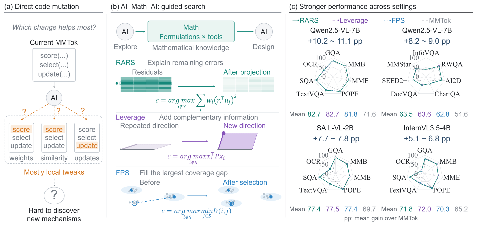
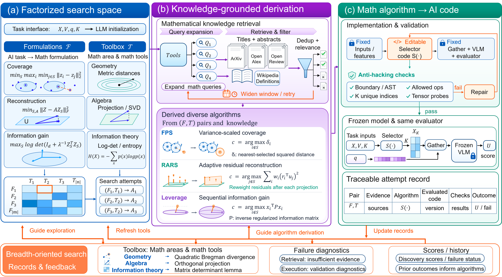
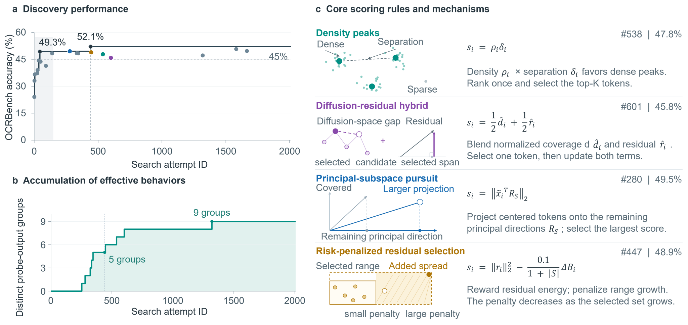

<h1 align="center">AI–Math–AI</h1>
<h3 align="center">Structuring Algorithm Search with Mathematics</h3>

<p align="center">
  Research code and experiment records accompanying the manuscript<br>
  <em>AI–Math–AI: Structuring Algorithm Search with Mathematics</em>
</p>

<p align="center">
  <a href="#overview">Overview</a> ·
  <a href="#method">Method</a> ·
  <a href="#results">Results</a> ·
  <a href="#using-the-selectors">Using the Selectors</a> ·
  <a href="#experiment-records">Experiment Records</a> ·
  <a href="#citation">Citation</a>
</p>

## Overview

**Can mathematical knowledge help AI discover better algorithms?** AI–Math–AI makes mathematical formulations and mathematical tools explicit dimensions of algorithm search. A formulation specifies what an algorithm should preserve or optimize; a tool supplies principles for constructing a solution. The system retrieves mathematical knowledge, derives an algorithm, implements and validates its code, and uses empirical feedback to guide subsequent exploration.

We study this approach through **visual-token reduction in frozen multimodal large language models**. Three representative selectors—**RARS**, **Leverage**, and **variance-scaled FPS**—translate reconstruction, information gain, and coverage into distinct token-selection mechanisms.

[](assets/figures/overview.svg)

*Mathematical reformulation guides visual-token selection. The radar plots show performance relative to full-token inference at 5% visual-token retention; pp denotes percentage points. Click any figure to view it at full resolution.*

The manuscript reports:

- **Improved discovery under a shared attempt budget.** The full framework reaches 49.3% OCRBench accuracy within 150 attempts, compared with 40.2% for the strongest tested evolutionary control.
- **Complementary selection mechanisms.** Reconstruction, sequential information gain, and variance-scaled coverage yield effective selectors without updating model weights.
- **Generalization across tasks and backbones.** At 5% token retention, the three selectors retain 72.3–73.2% of full-token performance across 14 Qwen2.5-VL-7B benchmarks, compared with 63.1% for MMTok. The study also evaluates transfer to SAIL-VL-2B and InternVL3.5-4B.

## Method

[](assets/figures/framework.svg)

*Mathematical choices are connected to executable algorithms through retrieval, derivation, implementation, and evaluation. Attempt records retain the selected formulation and tool, retrieved evidence, algorithm, evaluated code, checks, and outcome.*

1. **Explore formulations and tools.** Select a preservation objective and a mathematical tool from a reusable toolbox.
2. **Derive an algorithm from mathematical knowledge.** Expand retrieval queries, filter relevant sources, and specify initialization, selection rules, state updates, and termination.
3. **Implement and evaluate.** Generate code within a fixed task interface, validate it, and evaluate the resulting selector with a frozen model.
4. **Use feedback to continue discovery.** Scores, failures, and search history guide subsequent choices and toolbox expansion.

### Representative selectors

| Selector | Mathematical perspective | Selection principle | Source |
| :--- | :--- | :--- | :--- |
| **RARS** — Risk-Averse Residual Selection | Weighted residual reconstruction | Prioritize directions that explain remaining reconstruction error, with adaptive residual-dependent weights. | [rars.py](algorithm/rars.py) |
| **Leverage** | Sequential information gain | Select complementary feature directions using leverage scores and sequential state updates. | [leverage.py](algorithm/leverage.py) |
| **Variance-scaled FPS** | Coverage in a diagonal Mahalanobis geometry | Repeatedly select the token farthest from the selected set after feature-wise variance scaling. | [fps.py](algorithm/fps.py) |

The shared interface takes selection features $X \in \mathbb{R}^{N \times d}$, aligned model-input embeddings $V \in \mathbb{R}^{N \times d_v}$, an optional question, and a budget $K$. A selector returns sorted token indices; the surrounding model integration gathers the corresponding embeddings and preserves their sequence order.

## Results

**The following results are reported in the accompanying manuscript.** They summarize its experiments; they are not new measurements of this repository snapshot. Discovery, downstream evaluation, and timing use the separate protocols described below.

### Discovery under 150 attempts

| Search configuration | Best OCRBench accuracy (%) ↑ | Top-5 mean (%) ↑ | Algorithm types at ≥40% ↑ | First attempt reaching 40% ↓ |
| :--- | ---: | ---: | ---: | ---: |
| EoH-style | 39.20 | 37.46 | 0 | >150 |
| FunSearch-style | 39.90 | 39.34 | 0 | >150 |
| ShinkaEvolve-style | 40.20 | 39.88 | 1 | 43 |
| **AI–Math–AI** | **49.30** | **46.94** | **5** | **36** |

Each configuration has **one run of 150 attempts**, including failures and bounded repairs. The controls are task-specific adaptations. Search uses all 1,000 OCRBench samples, frozen Qwen2.5-VL-7B, 5% token retention, fixed pixel bounds of 1,605,632, and batch size 16. The budget matches attempt counts; computation per attempt can differ across methods.

[](assets/figures/discovery.svg)

*Extended search reaches 52.1% OCRBench accuracy at attempt 441. Among added-tool algorithms scoring at least 45%, the number of distinct token-selection groups grows from five at attempt 441 to nine at attempt 1320. These probe-based groups are distinct from the algorithm-type counts in the matched-budget table.*

### Downstream performance at 5% token retention

| Method | Qwen2.5-VL-7B · 14 tasks | SAIL-VL-2B · 7 tasks | InternVL3.5-4B · 7 tasks |
| :--- | ---: | ---: | ---: |
| Full tokens (reference) | 100.0 | 100.0 | 100.0 |
| MMTok | 63.1 | 69.7 | 65.2 |
| **RARS** | 73.1 | 77.4 | 71.8 |
| **Leverage** | **73.2** | **77.5** | **72.0** |
| **Variance-scaled FPS** | 72.3 | 77.4 | 70.3 |

Values are **mean performance retention (%)**, with higher values indicating better preservation of full-token performance. For each task, retention is $100 \times s_{\mathrm{selector}} / s_{\mathrm{full}}$; task ratios are averaged equally before rounding. Each backbone uses its own full-token reference. These values are normalized performance ratios, rather than raw task accuracies.

The seven reference tasks are **GQA, MMBench, MME, POPE, TextVQA, ScienceQA-IMG, and OCRBench**. Qwen evaluation additionally includes **InfoVQA, RealWorldQA, AI2D, ChartQA, DocVQA, SEED-Bench-2-Plus, and MMStar**. Qwen uses native dynamic resolution; the two transfer backbones use native dynamic tiling. Final evaluation uses frozen weights, matched per-image token budgets, and greedy decoding. The manuscript also reports 10% and 20% token budgets.

### Inference efficiency

| Method | Selection (ms) ↓ | TTFT (ms) ↓ | E2E (ms) ↓ | TTFT speedup ↑ |
| :--- | ---: | ---: | ---: | ---: |
| Full tokens | — | 428.6 | 451.3 | 1.00× |
| MMTok | 10.4 | 296.5 | 318.9 | 1.45× |
| **RARS** | 10.6 | 298.3 | 320.3 | 1.44× |
| **Leverage** | 29.0 | 313.8 | 335.8 | 1.37× |
| **Variance-scaled FPS** | 9.9 | 297.9 | 320.4 | 1.44× |

Timing uses **Qwen2.5-VL-7B, 100 OCRBench images, one NVIDIA A800 80 GB, and batch size 1**, with fixed pixel bounds of 1,605,632. Approximately 2,094 visual tokens are reduced to 104. CUDA events measure GPU execution after preprocessing and GPU transfer; the reported values average per-image medians over three repetitions following eight warm-up runs. TTFT generates one token; E2E generates two tokens. An empty compilation cache adds approximately 3.2 seconds to the first RARS call. These measurements describe this short-generation, warmed-up protocol.

## Repository structure

```text
AI-Math-AI/
├── algorithm/
│   ├── rars.py                     # RARS, including a Triton path
│   ├── leverage.py                 # Exported Leverage implementation
│   └── fps.py                      # Variance-scaled farthest-point sampling
├── lmms-eval/
│   ├── autoresearch_main.py        # Search orchestration
│   ├── autoresearch_common.py      # Shared configuration and utilities
│   ├── autoresearch_explorer/      # Mathematical exploration and retrieval
│   ├── autoresearch_coder/         # Code generation, checks, and repair
│   └── autoresearch_tasks/         # Task interfaces and prompt snapshots
├── assets/figures/                 # Figures reused from the manuscript
├── records/
│   ├── run_records.zip            # Iterations, candidates, logs, and results
│   └── historical_snapshot.zip    # Separately retained historical records
├── MANIFEST.json                   # Source-export manifest
├── SANITIZATION_REPORT.json        # Source-export sanitization metadata
├── PACKAGING.json                  # Archive checksums and packaging verification
├── requirements.txt
├── pyproject.toml
└── LICENSE
```

## Using the selectors

The three algorithm modules expose `QwenAlgorithmCore.select_vision_tokens(...)`. The following example runs directly from the repository root in an environment with PyTorch. It illustrates the tensor interface using synthetic inputs; a model integration must supply aligned features and embeddings from the actual vision encoder.

```python
import torch
from algorithm.rars import QwenAlgorithmCore

# Alternatively import QwenAlgorithmCore from algorithm.leverage or algorithm.fps.
torch.manual_seed(0)
features = torch.randn(128, 64)     # [number of tokens, selection feature dimension]
embeddings = torch.randn(128, 256) # Aligned embeddings supplied to the language model

selector = QwenAlgorithmCore()
with torch.inference_mode():
    indices = selector.select_vision_tokens(
        image_embeds=embeddings,
        image_features=features,
        target_vision_tokens=16,
    )
    selected_embeddings = embeddings[indices]

print(indices.shape, selected_embeddings.shape)
# torch.Size([16]) torch.Size([16, 256])
```

Use a nonempty feature matrix and a budget satisfying `1 <= K <= N`, with features and embeddings on the same device. RARS includes a Triton path for supported CUDA inputs and fallback implementations. Both the selected backend and input shape affect runtime.

### Reproduction scope

This repository distributes algorithm snapshots, AutoResearch source, and compressed experiment records. Full model evaluation requires the surrounding MMTok/model integration, the evaluation harness, model weights, datasets, and experiment-specific configuration. Search also requires configured LLM and retrieval services. The exported source contains anonymized local paths that must be adapted to the execution environment.

The supplied dependency files preserve the original export. In particular, `pyproject.toml` describes the parent `mmtok` package, whose full source is not included here; it is not a complete installation specification for this artifact. A clean installation and end-to-end reproduction of the manuscript tables have not been validated for this export.

## Experiment records

| Archive | Contents | Files | Download size |
| :--- | :--- | ---: | ---: |
| [run_records.zip](records/run_records.zip) | Search iterations, generated candidates, logs, and evaluation records | 16,708 | 77.52 MiB |
| [historical_snapshot.zip](records/historical_snapshot.zip) | Historical code, result summary, exploration tree, and log | 4 | 1.72 MiB |

Restore the records from the repository root:

```bash
unzip records/run_records.zip -d .
unzip records/historical_snapshot.zip -d .
```

The archives preserve their original relative paths and restore `lmms-eval/autoresearch_iterations_ocrbench_qwen_mech/` and `historical_snapshot/`. Extracted directories are ignored by Git to avoid committing duplicate records.

Archive SHA-256 checksums, sizes, and packaging verification results are recorded in [PACKAGING.json](PACKAGING.json). All files from the source export were included directly or in an archive, and archive contents were checked against the source file hashes before upload. [MANIFEST.json](MANIFEST.json) and [SANITIZATION_REPORT.json](SANITIZATION_REPORT.json) retain the original export metadata. Packaging verification establishes file integrity; it does not establish experimental reproducibility.

## Citation

The accompanying manuscript is **AI–Math–AI: Structuring Algorithm Search with Mathematics**. The supplied manuscript is anonymized; a formal bibliographic entry is pending public author and publication metadata. When referring to this code artifact, include the [repository URL](https://github.com/newLLing/AI-Math-AI) and the commit used in your experiments.

## License and figure provenance

The repository includes the [Apache License 2.0](LICENSE). Existing source notices are retained.

The three figures above are reused from the accompanying manuscript. Each SVG embeds the original PNG bytes over a white background for readability in both light and dark themes; labels, equations, and plotted values are unchanged. Source filenames and SHA-256 hashes are documented in [assets/figures/sources.json](assets/figures/sources.json).
